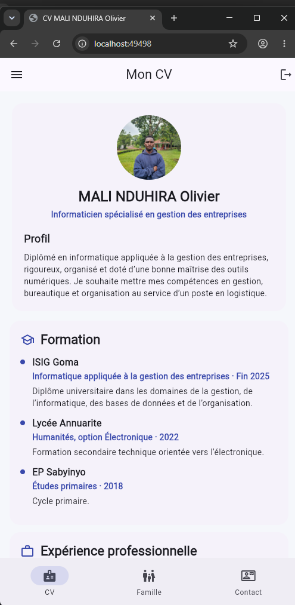

# CV Flutter — MALI NDUHIRA Olivier

Application mobile Flutter présentant le curriculum vitae, la famille et les coordonnées de MALI NDUHIRA Olivier.

## Fonctionnalités

- Page de connexion avec mot de passe masqué.
- Identifiant : `olivier`.
- Mot de passe : `12345`.
- Page CV avec profil, formations, expériences, compétences et langues.
- Page Famille avec les membres et leurs photos.
- Page Contact avec téléphone, e-mail et adresse cliquables.
- Navigation par barre inférieure, menu latéral et bouton de déconnexion.

## Captures d’écran

### Connexion


### CV



### Famille


### Contact


## Exécution

```bash
flutter pub get
flutter run -d chrome
```

Pour Android :

```bash
flutter run -d android
```
